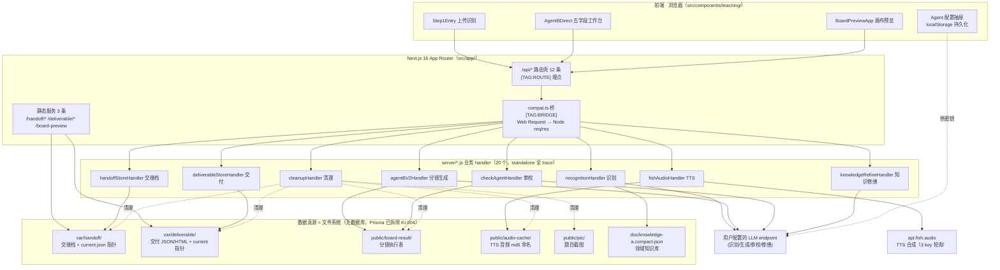
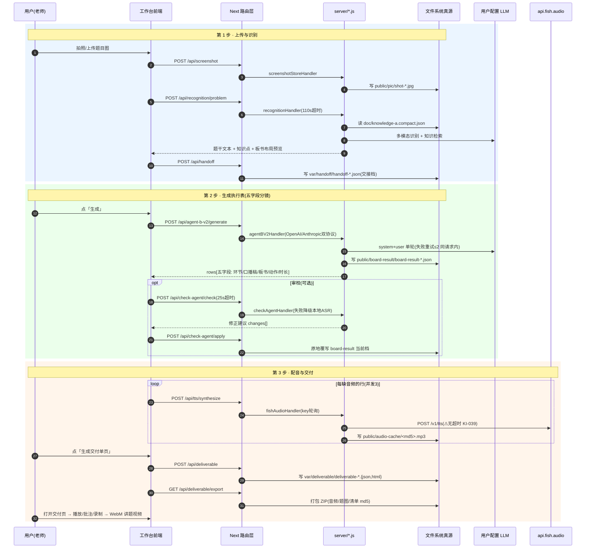
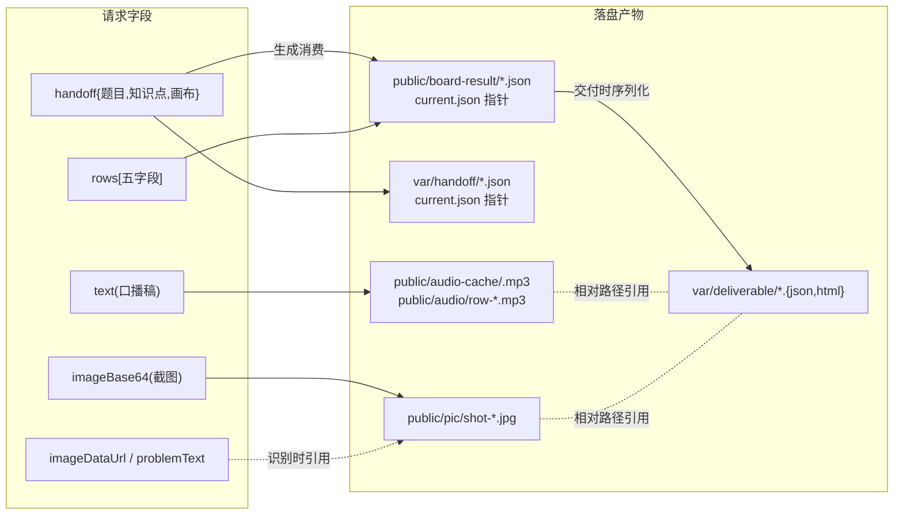
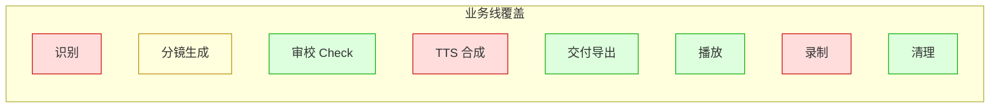

# 业务流图谱（指南针文档）

> 本文档是项目的**阵列图**：全链通路、数据流、API 映射、测试图谱一图在手。
> 维护铁律：**改路由/改存储/改业务流，必须同步改本文档**——不同步等于没改。
> 快速拉脉络：`rg "\[TAG:" src/ server/` 可一键抽出全部业务线埋点。
> 最近校验：2026-10-30（三路 Agent 全链勘探 + 11 项测试全 PASS + 穿越/防误杀实测）。

---

## 0. 架构总览

## 1. 黄金路径时序（三步出片）

## 2. 数据流图（字段 → 目录归属）

**指针约定**：`current.json` 存 `{projectCode, filename, createdAt}`，各读取端解析指针后回读实体档；指针失效时各 store 自愈重建（GET 带幂等写，见 KI 已知项）。

## 3. API 通路映射表（12+2 条，全链实测 2026-10-30）

| 路由 | 方法/action | handler | 读写 | 外呼 | 状态 |
|---|---|---|---|---|---|
| `/api/health` | GET | 内联 | 无 | 无 | ✓ |
| `/api/recognition/problem` | POST | recognitionHandler | 读 doc/ 知识库 | 用户 LLM(110s) | ✓ |
| `/api/screenshot` | POST | screenshotStoreHandler | 写 public/pic | 无 | ⚠GET 死分支 |
| `/api/agent-b-v2/generate` | POST | agentBV2Handler | 写 board-result | 用户 LLM(90s/300s) | ✓ |
| `/api/check-agent/check` | POST | checkAgentHandler | 读 board-result+handoff | 用户 LLM(25s) | ✓ |
| `/api/check-agent/apply` | POST | checkAgentHandler | 覆写 board-result | 无 | ✓ |
| `/api/tts/[[...action]]` | GET info; POST synthesize/save-local/batch | fishAudioHandler | 写 audio-cache | api.fish.audio ⚠无超时 | ⚠GET /api/tts 404 |
| `/api/knowledge/[action]` | POST refine/apply | knowledgeRefineHandler | 读写 var/handoff | 用户 LLM(60s) | ✓ |
| `/api/handoff/[[...action]]` | GET; POST | handoffStoreHandler | 读写 var/handoff | 无 | ✓ |
| `/api/deliverable/[[...action]]` | GET //list/export; POST /update-* | deliverableStoreHandler | 读写 var/deliverable | 无 | ✓ ⚠list/batch 死端点 |
| `/api/asset/[...path]` | GET/HEAD | 内联 | 读 public/ 4 目录 | 无 | ✓ 双层防穿越 |
| `/api/cleanup` | POST | cleanupHandler | 删 6 目录过期物 | 无 | ⚠破坏性 KI-039 |
| `/handoff/:name` | GET | 内联+store | 读 var/handoff | 无 | ✓ **KI-034 已修** |
| `/deliverable/:name` | GET | 内联+store | 读 var/deliverable+fonts | 无 | ✓ **KI-034 已修** |

> 前端可疑点（12 处 fetch 无超时、静默吞错、双真源等）明细见 `KNOWN_ISSUES.md` KI-036/KI-038/KI-039 与 `doc/AGENT_PLAYBOOK.md`。

## 4. 测试图谱（11 项，2026-10-30 全 PASS）

| 测试 | 盯什么业务契约 | 跑法 |
|---|---|---|
| test-math-consistency | 数学板书/口播一致性（3/4×20→4分之3乘以20） | node |
| test-prompt-cleanliness | 提示词样例+附录哈希钉死（附录已白名单化） | node |
| test-action-whitelist | 板书动作白名单（仅 underline/circle） | **bun** |
| test-check-teaching | Check 教风铁律/挤行/降级链 | **bun** |
| test-question-font / -player | 题目字体 30px 铁律（工作台+播放页+离线导出） | node / **bun** |
| test-row-player-gap | 行间 1s 停顿（KI-021） | node |
| test-row-uid-stability | 行身份 _rowUid + TTS 竞态 | node |
| test-cleanup-contract | 清理保活契约（tmp 沙箱） | node |
| test-deliverable-fonts | 字体服务+穿越拒绝（**含 KI-034 顶层穿越回归**） | node |
| test-handoff-route | **新增** handoff 特例+穿越回归（KI-034） | node |

**红区缺口（下轮测试补位方向）**：识别 prompt 构建（纯函数可测）、TTS 服务端契约（假上游桩）、录制链路（浏览器侧，需 e2e）。

## 5. 运行形态速查

| 形态 | 启动 | cwd | 写盘指向 |
|---|---|---|---|
| 沙箱生产（本仓正路） | `bash scripts/prod-serve.sh`（dev/start 同） | `.next/standalone` | 软链直连项目真身 var/doc/public×4 |
| 本机 dev | `bun run dev:next` | 项目根 | 同目录直写 |
| 发布部署 | `node server.js`（release 包内） | 包内 standalone | 包内目录（首次为快照副本） |

> 沙箱进程保活：`python3 scripts/daemonize_prod.py start|status|stop`（双 fork 脱离会话，见 AGENT_PLAYBOOK 第 1 条）。
